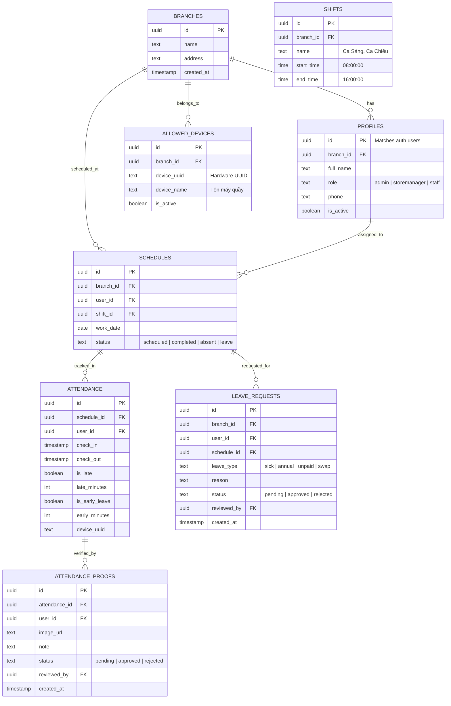

# KẾ HOẠCH PHÁT TRIỂN HỆ THỐNG CHẤM CÔNG CHUỖI NHÀ THUỐC
**Dự án:** Desktop Attendance Management System  
**Công nghệ:** Python (CustomTkinter) + Supabase (Serverless PostgreSQL, RLS, Storage)  
**Quy mô:** Nhiều chi nhánh (Multi-branch), 3 cấp bậc vai trò (`Admin`, `Store Manager`, `Staff`)  

---

## 1. TỔNG QUAN VÀ NGUYÊN TẮC THIẾT KẾ

### 1.1. Mục tiêu hệ thống
* Số hóa hoàn toàn việc chấm công, xếp ca, xin nghỉ và xuất báo cáo tính lương cho chuỗi nhà thuốc.
* Chi phí vận hành hạ tầng gần như 0 đồng (sử dụng gói miễn phí của Supabase).
* Chống gian lận chấm công tuyệt đối dù chạy mô hình không có Backend truyền thống.

### 1.2. Các nguyên tắc cốt lõi (Core Principles)
1. **Kỷ luật nghiêm túc (Zero Tolerance - Không du di):**
   * Ca bắt đầu lúc `08:00:00`. Chấm công từ `08:00:01` trở đi được tính là **Đi trễ**.
   * Số phút đi trễ được ghi nhận tự động và cộng dồn vào báo cáo tháng.
2. **Chống chỉnh giờ máy tính (Server-side Timestamp):**
   * Tuyệt đối không lấy thời gian từ máy tính Client (`datetime.now()`).
   * Giờ check-in/out được đóng dấu bằng hàm `NOW()` trong PostgreSQL RPC trên Supabase.
3. **Khóa cứng thiết bị theo Chi nhánh (Hardware Lock):**
   * Mỗi quầy thu ngân có một máy tính duy nhất. Lấy mã định danh phần cứng (Motherboard UUID / ProcessorId) qua PowerShell (`Get-CimInstance`).
   * Máy của Chi nhánh nào chỉ cho phép nhân viên thuộc Chi nhánh đó chấm công.
4. **Bảo mật dữ liệu qua Supabase Row Level Security (RLS):**
   * Nhân viên (`staff`) chỉ thấy dữ liệu cá nhân.
   * Cửa hàng trưởng (`storemanager`) chỉ thao tác dữ liệu nội bộ chi nhánh mình.
   * Chủ chuỗi (`admin`) toàn quyền trên toàn hệ thống.
5. **Tối ưu thao tác tại quầy (Fast Shift Handoff):**
   * Nút Đăng xuất nhanh (Quick Logout) giúp dược sĩ giao ca chấm công liên tiếp trên cùng 1 máy tính mà không bị nhầm tài khoản.
6. **Xử lý sự cố mạng & Tối ưu dung lượng:**
   * Bọc xử lý ngoại lệ mất mạng, hướng dẫn nhân viên chụp ảnh gửi giải trình sau.
   * Nén ảnh minh chứng bằng Pillow (< 500KB) trước khi đẩy lên Supabase Storage.

---

## 2. KIẾN TRÚC VÀ CÔNG NGHỆ

```
+---------------------------------------------------------------+
|                      DESKTOP CLIENT (Python)                  |
|  - CustomTkinter (Single-Frame Switching Navigation)          |
|  - Pillow (Nén ảnh giải trình)                                |
|  - openpyxl (Xuất báo cáo Excel)                              |
|  - PowerShell CIM / WMI (Lấy Hardware UUID)                   |
+---------------------------------------------------------------+
                               │
                HTTPS / TLS (Supabase Client SDK)
                               │
                               ▼
+---------------------------------------------------------------+
|                      SUPABASE CLOUD                           |
|  - Supabase Auth (Quản lý phiên & xác thực)                   |
|  - PostgreSQL with RLS (Tự lọc dữ liệu theo Branch & Role)    |
|  - Stored Procedures / RPC (Hàm Check-in/out đóng dấu giờ)    |
|  - Supabase Storage (Bucket: attendance_proofs)               |
+---------------------------------------------------------------+
```

* **Ngôn ngữ:** Python 3.10+
* **Thư viện chính:**
  * `customtkinter` (Giao diện hiện đại)
  * `supabase` (SDK kết nối trực tiếp Supabase)
  * `pillow` (Xử lý và nén ảnh)
  * `openpyxl` (Kết xuất báo cáo Excel `.xlsx`)
  * `python-dotenv` (Quản lý cấu hình môi trường)
* **Đóng gói phát hành:** `PyArmor` (Obfuscate bảo vệ mã nguồn) + `PyInstaller` (Đóng gói `.exe`).

---

## 3. THIẾT KẾ CƠ SỞ DỮ LIỆU (SUPABASE SCHEMA)



---

## 4. CHI TIẾT 6 MÀN HÌNH (GIAO DIỆN CUSTOMTKINTER)

Ứng dụng sử dụng cấu trúc **Single-Frame Controller**: Chỉ có một cửa sổ chính duy nhất, chuyển đổi qua lại giữa các Frame bằng `pack()` và `pack_forget()`.

### Màn 1: Đăng nhập (Login Frame)
* **Chức năng:** Nhập Email & Mật khẩu.
* **Xác thực thiết bị ngầm:** Lấy UUID máy tính hiện tại kiểm tra với bảng `allowed_devices`. Nếu máy chưa đăng ký -> Chặn đăng nhập (trừ tài khoản có role `admin`).
* **Phân quyền điều hướng:** Sau khi đăng nhập, dựa vào `role` để bật/tắt các Menu tính năng tương ứng.

### Màn 2: Điểm danh quầy (Attendance Frame)
* **Chức năng:** Màn hình chính sau khi đăng nhập cho nhân viên đứng quầy.
* **Thành phần:**
  * Đồng hồ kỹ thuật số thời gian thực (hiển thị ngày, giờ quầy).
  * Thông tin ca hôm nay của nhân viên đang đăng nhập.
  * Hai nút bấm lớn: **[ CHECK-IN ]** và **[ CHECK-OUT ]**.
    * Trạng thái nút tự động cập nhật: Đã check-in thì khóa nút Check-in, mở nút Check-out.
    * Gọi RPC `rpc_check_in` / `rpc_check_out` để server tự ghi nhận giờ `NOW()`.
    * Cảnh báo chữ đỏ ngay nếu đi trễ: *"Trễ X phút (Giờ ca: 08:00 - Giờ chấm: 08:06)"*.
  * **Nút "Đăng xuất nhanh":** Đổi sang dược sĩ tiếp theo giao ca.

### Màn 3: Lịch làm việc & Xin nghỉ (Schedule & Leave Modal)
* **Chức năng:** Hiển thị lịch phân ca trực quan theo Tuần / Tháng.
* **Phân quyền:**
  * `staff`: Chỉ xem lịch của mình. Nhấp đúp vào ca làm việc để mở **Pop-up Xin nghỉ phép** (chọn lý do, nhập ghi chú).
  * `storemanager`: Xem lịch toàn bộ nhân viên chi nhánh mình. Click vào ô trống để thêm/xếp ca hoặc đổi ca trực.
  * `admin`: Có thêm Dropdown chọn xem và phân lịch cho từng Chi nhánh.

### Màn 4: Trung tâm Phê duyệt (Approval Center)
Dành cho `storemanager` (duyệt trong tiệm) và `admin` (toàn quyền):
* **Tab 1 - Duyệt đơn xin nghỉ:** Danh sách đơn chờ duyệt. Bấm **Duyệt** -> Hệ thống tự đổi trạng thái ca trên Lịch làm việc thành `leave` (màu vàng) và đánh dấu ca đó cần người trực thay.
* **Tab 2 - Duyệt quên chấm công:** Danh sách yêu cầu giải trình kèm ảnh chụp bằng chứng (được load trực tiếp từ Supabase Storage). Bấm **Duyệt** -> Cho phép sửa/bổ sung giờ chấm công hợp lệ.

### Màn 5: Báo cáo & Xuất Excel (Reports & Export)
Dành cho `storemanager` và `admin`:
* Bộ lọc: Chọn Tháng, Năm (Admin có thêm chọn Chi nhánh).
* Bảng thống kê tổng hợp:
  * Tổng số công chuẩn / Tổng số công thực tế.
  * Tổng số lần đi trễ & Tổng số phút trễ lũy kế.
  * Số ngày nghỉ có phép / không phép.
* Nút bấm: **[ Xuất File Excel (.xlsx) ]** (dùng `openpyxl` định dạng bảng lương/chấm công đẹp mắt).

### Màn 6: Quản trị Chi nhánh & Nhân sự (System Settings)
Chỉ hiển thị cho tài khoản `admin`:
* Quản lý danh sách Chi nhánh (Thêm/Sửa tên, địa chỉ).
* Quản lý Tài khoản Dược sĩ (Tạo tài khoản, chọn Chi nhánh, phân Role: `staff`, `storemanager`, `admin`).
* Cấp phép thiết bị: Nhập mã UUID máy tính quầy và gán cho Chi nhánh tương ứng.

---

## 5. LỘ TRÌNH TRIỂN KHAI CHI TIẾT (ROADMAP)

### Giai đoạn 1: Thiết lập Supabase & Viết kịch bản Database (Day 1)
- [ ] Khởi tạo Project Supabase mới.
- [ ] Chạy file Script SQL: Tạo toàn bộ bảng, khóa ngoại, ràng buộc Enum.
- [ ] Thiết lập Storage Bucket `attendance_proofs` và chính sách bảo mật tệp.
- [ ] Viết các PostgreSQL Functions (RPC):
  - `rpc_check_in(p_schedule_id, p_device_uuid)` (Đóng dấu giờ server `NOW()`, so sánh giờ ca, tính `late_minutes`).
  - `rpc_check_out(p_attendance_id)` (Tính `early_minutes` nếu về trước giờ tan ca).
- [ ] Thiết lập toàn bộ các chính sách RLS (Row Level Security) cho 3 Roles.

### Giai đoạn 2: Xây dựng Khung ứng dụng CustomTkinter (Day 2 - 3)
- [ ] Xây dựng `AppController` quản lý luồng Single-Frame Switching.
- [ ] Viết module `hardware_id.py` (Lấy UUID máy tính quầy qua PowerShell CIM, chống lỗi trên Windows 11).
- [ ] Xây dựng Module kết nối Supabase (`supabase_client.py`).
- [ ] Hoàn thiện **Màn 1 (Đăng nhập)** và cơ chế phân quyền UI theo Role.
- [ ] Hoàn thiện **Màn 2 (Điểm danh)** kết nối hàm RPC, xử lý nút Đăng xuất nhanh.

### Giai đoạn 3: Phân ca, Xin nghỉ & Phê duyệt (Day 4 - 5)
- [ ] Xây dựng giao diện bảng Lịch tuần/tháng trên **Màn 3**.
- [ ] Xây dựng Pop-up Xin nghỉ phép cho Staff và chức năng Xếp ca cho Manager.
- [ ] Xây dựng **Màn 4 (Trung tâm Phê duyệt)**:
  - Tích hợp nén ảnh Pillow trước khi upload đơn giải trình.
  - Xử lý nghiệp vụ tự cập nhật Lịch khi đơn nghỉ được phê duyệt.

### Giai đoạn 4: Báo cáo Excel & Cài đặt hệ thống (Day 6)
- [ ] Xây dựng **Màn 5**: Truy vấn tính toán tổng hợp dữ liệu chấm công và xuất file `.xlsx` bằng `openpyxl`.
- [ ] Xây dựng **Màn 6**: Giao diện Quản trị Chi nhánh, Phân quyền User và Đăng ký máy quầy cho Admin.
- [ ] Xử lý kịch bản lỗi mạng (`try...except`), hiển thị thông báo thân thiện.

### Giai đoạn 5: Kiểm thử, Tối ưu & Đóng gói .exe (Day 7)
- [ ] Test toàn diện các trường hợp: Đi trễ 1 phút, đổi ca liên tục trên 1 máy, đăng nhập khác máy quầy, mất mạng.
- [ ] Mã hóa bảo vệ chuỗi kết nối và logic ứng dụng bằng `PyArmor`.
- [ ] Đóng gói ứng dụng thành file `.exe` duy nhất bằng `PyInstaller`.
- [ ] Bàn giao tài liệu hướng dẫn vận hành cho Chủ nhà thuốc.
